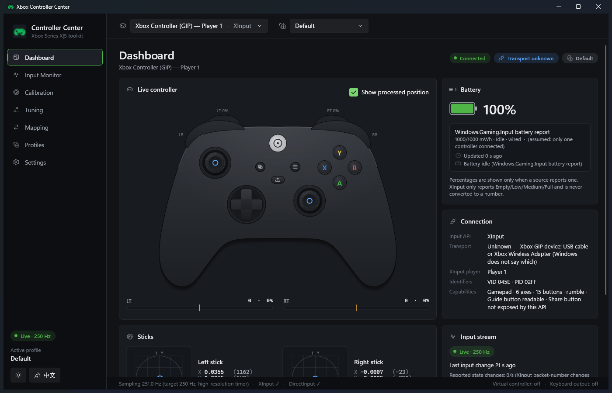
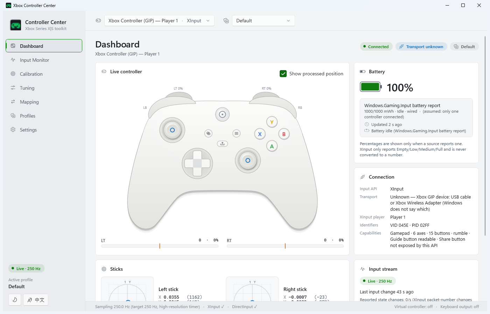
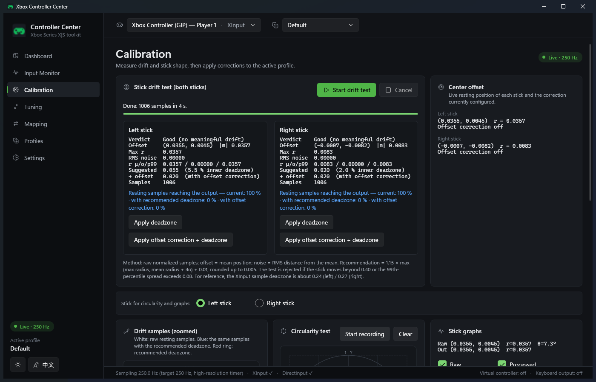
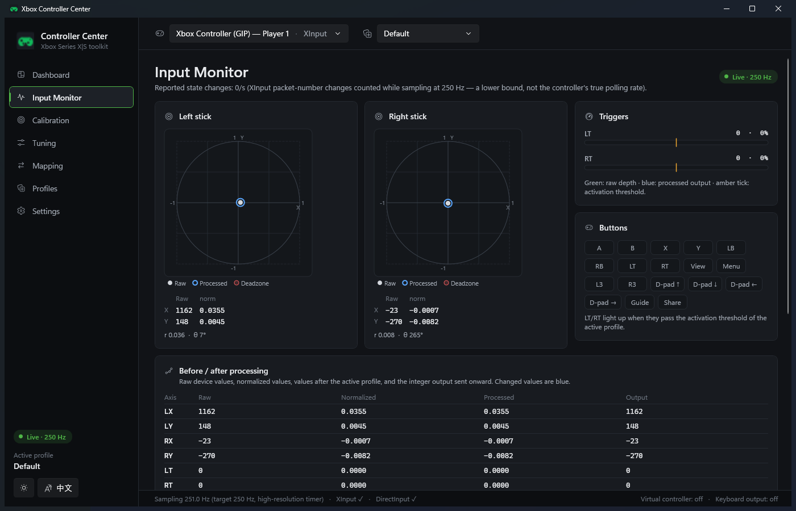
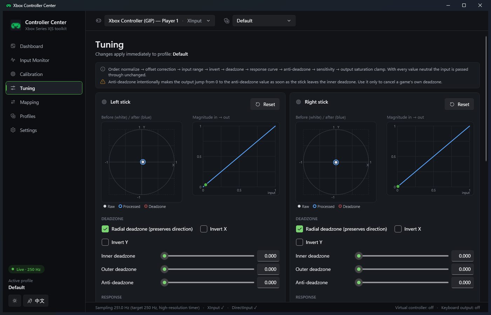
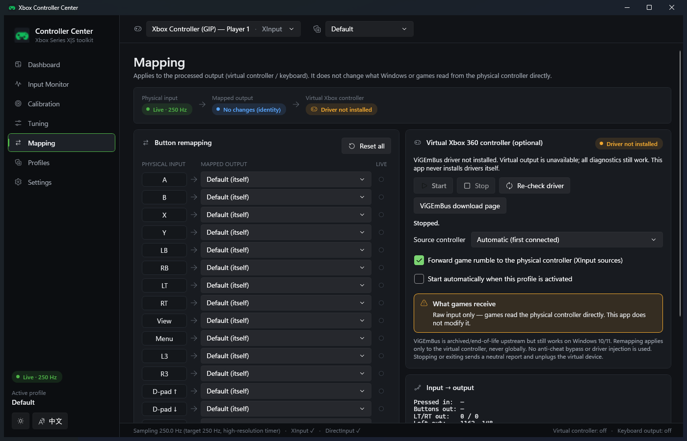

# Xbox Controller Center

A free, open-source (GPL-3.0-or-later) Windows app for testing, monitoring, calibrating and remapping
game controllers: Xbox Series X|S / Xbox One / Xbox 360, other XInput controllers and generic DirectInput gamepads.
No account, no cloud, no telemetry, no installer, no admin rights for normal use.

> 繁體中文：這是一套免費、開源（GPL-3.0-or-later）的 Windows 控制器工具，提供即時輸入監看、搖桿飄移與死區診斷、
> 誠實的藍牙電量顯示、搖桿／扳機調校、按鍵對應、設定檔，以及選用的虛擬 Xbox 360 控制器輸出。介面可即時切換英文／繁體中文。

## Screenshots

| Dashboard (dark) | Dashboard (light) |
|---|---|
|  |  |
| **Calibration — real drift test** | **Input Monitor** |
|  |  |
| **Tuning** | **Mapping** |
|  |  |

The controller drawing is original vector artwork with the real Xbox Series X|S layout (asymmetric sticks, hybrid
D-pad, Share button); pressed inputs light up live — see [controller at 2× scale](docs/screenshots/controller-pressed-2x.png)
and the [design system](docs/UI_DESIGN.md). All screenshots show live data from a real controller.

## Features

| Area | What it does |
|---|---|
| **Detection** | XInput and DirectInput controllers, hot-plug without restart, XInput devices de-duplicated from DirectInput (Microsoft "IG_" rule), player slot, VID/PID, capabilities, transport when Windows exposes it. |
| **Battery** | Priority: Bluetooth LE GATT Battery Service (0x180F/0x2A19) → Windows Bluetooth battery property (only while connected) → Windows.Gaming.Input report → XInput coarse level. Shows source, update age, stale state, charging state when reported, low-battery warning + tray notification, and an **estimated runtime measured from the controller's own GATT readings** (shown only after a real drop has been observed; no source reports runtime directly). XInput Low/Medium/Full is **never** turned into a percentage. |
| **Live monitor** | Controller drawing with pressed buttons, raw + normalized stick values, trigger raw/percent, raw vs processed overlay, 1–30 s history graphs, measured sampling rate and state-change rate, raw DirectInput data. |
| **Connection quality** | Measured from the input itself (Windows exposes no signal strength for a connected Bluetooth controller): update spacing while moving (median / 95 % / longest), suspected stalls during continuous movement, and a persistent local log of connections, disconnections (flagged when the controller came back within 2 min) and stalls, to compare before/after changing antenna, Wi-Fi band or distance. |
| **Diagnostics** | Automated drift test for both sticks (mean offset, max offset, RMS noise, radial statistics, recommended deadzone with/without offset correction, rejects movement); circularity test with angular coverage and error metrics for raw and processed output; zoomable graphs. |
| **Tuning** | Per stick: radial/axial inner deadzone, outer deadzone, anti-deadzone, sensitivity, response curve (linear, power, S-curve, custom points), X/Y inversion, per-axis input range, output saturation, center offset correction — live before/after preview and curve plot. Per trigger: deadzone, full-press point, anti-deadzone, sensitivity, curve, activation threshold. |
| **Mapping** | Button ↔ button, disable, trigger ↔ button, optional keyboard keys (opt-in, always released), input → output comparison. |
| **Virtual controller** | Optional Xbox 360 output via the user-installed ViGEmBus driver: processed input, rumble forwarding, feedback-loop protection, neutral on disconnect/stop/exit, clear "what games receive" explanation. |
| **In-game overlay** | Hold both sticks in (L3 + R3) for 0.5 s, or press a global keyboard shortcut (default Ctrl + Alt + O, changeable), to show or hide a click-through status panel over the game: battery and estimated runtime per controller, connection quality, active profile, virtual/keyboard output state and the time. Never takes focus; optional auto-hide. Needs borderless/windowed games. |
| **Profiles** | Default/Racing/FPS/Emulator presets, create/duplicate/rename/delete (confirmed)/import/export, reset, per-game and per-controller association with optional auto-switching, versioned JSON with migration, corrupted files reported and never overwritten. |
| **UI** | Fluent-style WPF UI with dark (default) and light themes, Xbox-green accent, Fluent UI System Icons, responsive card layout, English and Traditional Chinese switchable at runtime, keyboard navigation, per-monitor DPI, tray icon. Rendering (15–60 FPS) is decoupled from 60–1000 Hz input sampling and only redraws what changed. |

## Download / run

1. Get `XboxControllerCenter-<version>-win-x64.zip` (from GitHub Actions artifacts or `build/publish.ps1`).
2. Verify it against `SHA256SUMS.txt`.
3. Extract anywhere and run `XboxControllerCenter.exe`. Windows 10 1809+ / Windows 11, x64. No .NET installation needed.

Settings are stored in `.\data` next to the exe (portable mode, enabled by the shipped `portable.txt`), or in
`%LOCALAPPDATA%\XboxControllerCenter` if that folder is not writable or `portable.txt` is deleted.
Windows SmartScreen may warn because the executable is not code-signed.

### Optional: virtual Xbox controller

Install the ViGEmBus driver yourself from https://github.com/nefarius/ViGEmBus/releases, then use *Mapping →
Virtual Xbox 360 controller*. Read [docs/VIRTUAL_CONTROLLER.md](docs/VIRTUAL_CONTROLLER.md) first:
**a physical Xbox controller stays visible to XInput games**, so games may see both controllers.

## Usage tips

- **Drift:** *Diagnostics → Start drift test*, leave the controller untouched for ~6 s, then *Apply deadzone*
  (or *Apply offset correction + deadzone*). The value is written to the active profile.
- **Tuning** takes effect immediately; invalid combinations are rejected with an explanation.
- **Keyboard mapping** does nothing until *Mapping → Enable keyboard output* is turned on and confirmed.

## Build from source

Requirements: Windows, [.NET 10 SDK](https://dotnet.microsoft.com/download/dotnet/10.0).

```powershell
dotnet build XboxControllerCenter.slnx -c Release
dotnet test tests/XboxControllerCenter.Core.Tests -c Release
dotnet run --project src/XboxControllerCenter.App          # debug run
./build/publish.ps1                                         # dist/XboxControllerCenter-<ver>-win-x64.zip + SHA256SUMS.txt
```

`build/make-icon.ps1` regenerates the (original) application icon; `build/gen-icons.sh` regenerates the UI icon
geometries from Fluent UI System Icons (MIT). CI: `.github/workflows/build.yml` builds, tests
and packages on `windows-latest`.

## Documentation

- [docs/UI_DESIGN.md](docs/UI_DESIGN.md) — design tokens, components, controller drawing spec, performance, changed files
- [docs/ARCHITECTURE.md](docs/ARCHITECTURE.md) — projects, threads, data flow, storage
- [docs/PROCESSING_PIPELINE.md](docs/PROCESSING_PIPELINE.md) — exact math and order of operations
- [docs/VIRTUAL_CONTROLLER.md](docs/VIRTUAL_CONTROLLER.md) — driver, safety, double input
- [docs/HARDWARE_TEST_CHECKLIST.md](docs/HARDWARE_TEST_CHECKLIST.md) — what was and was not tested on hardware
- [docs/KNOWN_LIMITATIONS.md](docs/KNOWN_LIMITATIONS.md)
- [DEPENDENCIES.md](DEPENDENCIES.md) — reference projects, licenses, decisions
- [THIRD_PARTY_NOTICES.md](THIRD_PARTY_NOTICES.md)

## License

GPL-3.0-or-later — see [LICENSE](LICENSE). Bundled third-party components are listed in
[THIRD_PARTY_NOTICES.md](THIRD_PARTY_NOTICES.md). "Xbox" is a trademark of Microsoft; this project is not
affiliated with Microsoft.
